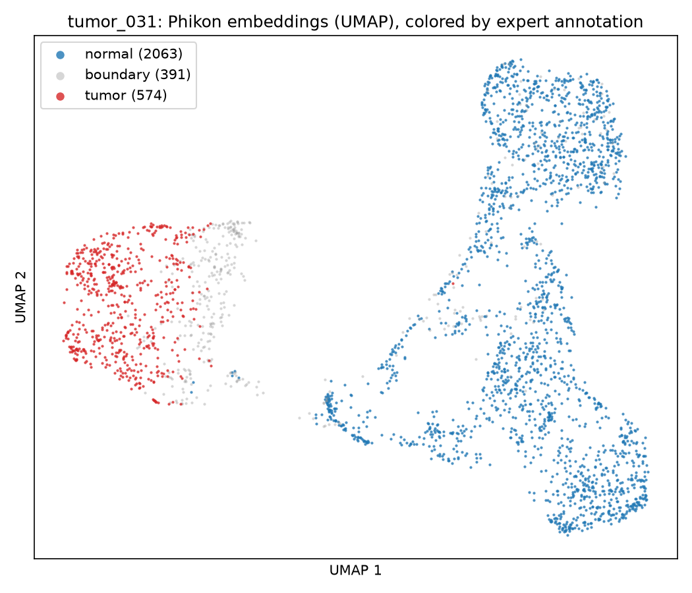
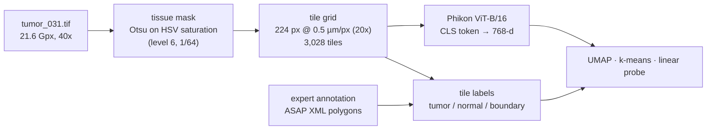
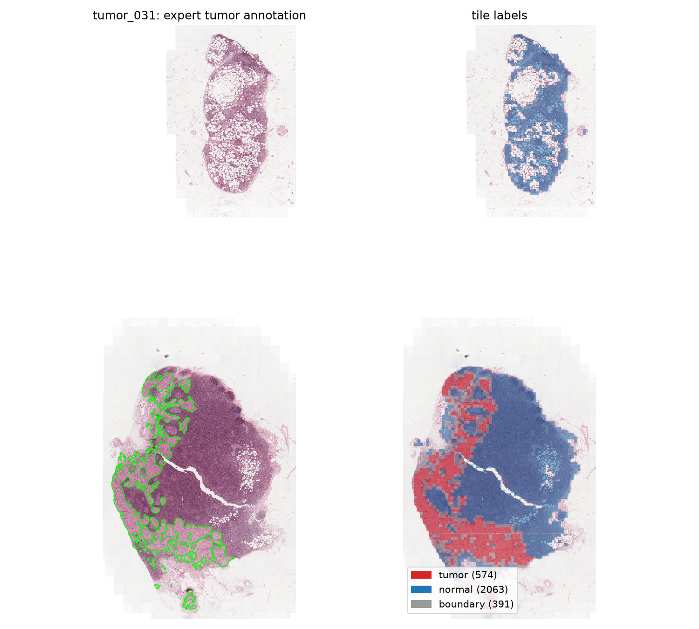
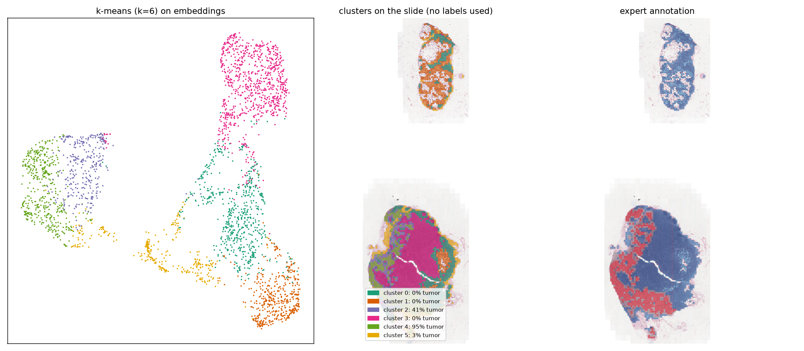
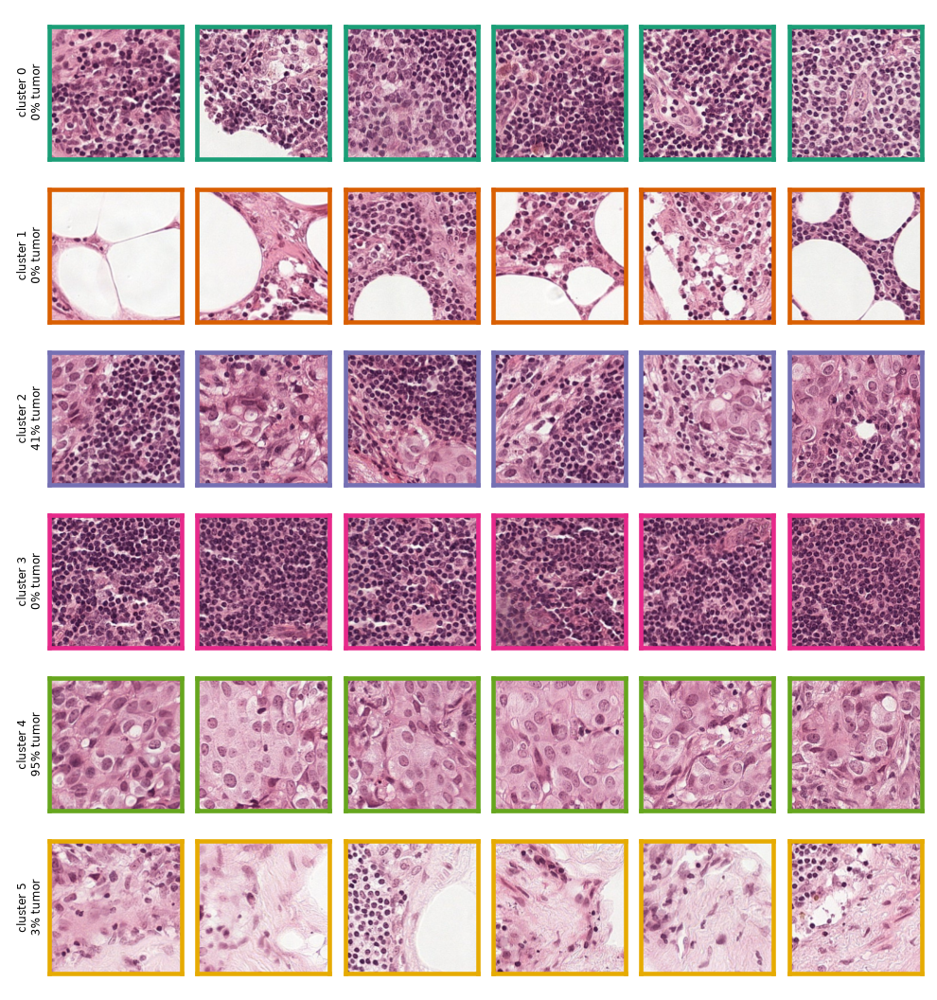
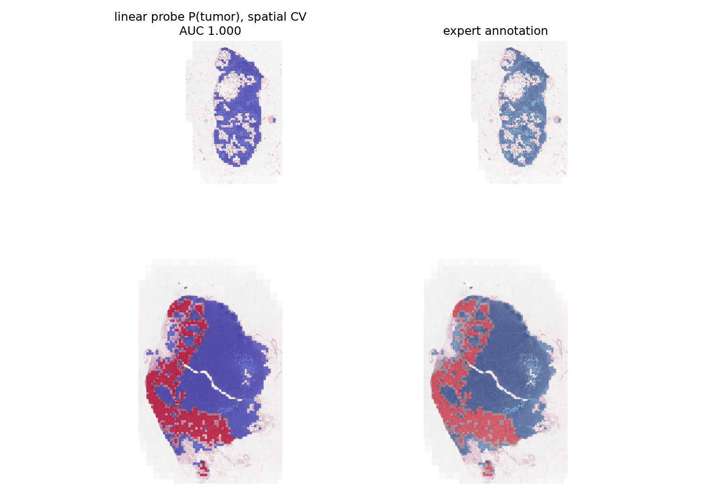

# Whole-slide image embeddings with a pathology foundation model

From a gigapixel H&E slide to tile-level embeddings from **Phikon**, a self-supervised pathology foundation model, and a check of what those embeddings encode.

The test case is one lymph-node slide with a breast-cancer metastasis from CAMELYON16 (`tumor_031`).



**Main result:** Phikon was pretrained without labels, on TCGA rather than CAMELYON16, and it was never fine-tuned here. Even so, it places the tumor tiles in their own region of embedding space. Unsupervised k-means on the embeddings recovers the tissue structure of the lymph node: tumor, the tumor–lymphocyte interface, dense lymphocytes, fat and capsule/stroma. A linear probe separates tumor from normal tiles with spatially cross-validated AUC = 1.000 (0.987 when ambiguous border tiles are included). See [Limitations](#limitations) before reading too much into that number.

## Why

A whole-slide image (WSI) is far too large to feed to a neural network directly. `tumor_031` is 97,792 × 221,184 px at level 0, about 21.6 gigapixels or ~65 GB as raw RGB. The standard recipe has three parts:

1. Cut the tissue into small tiles at a fixed magnification.
2. Turn each tile into a vector with a frozen **foundation model**, i.e. a ViT pretrained with self-supervised learning on millions of histology tiles.
3. Do the downstream task (classification, retrieval, survival, ...) on those vectors, often with multiple-instance learning.

This project builds steps 1–2 from scratch and asks a simple question about step 3: *what do the embeddings already know, before any task-specific training?*

## Pipeline



| step | script | module | time (M2 Pro) |
|---|---|---|---|
| tissue mask + 20x tile grid | `scripts/tile_slide.py` | `wsi.tiling` | ~1 s |
| labels from annotations | `scripts/label_tiles.py` | `wsi.annotations` | ~5 s |
| Phikon embeddings | `scripts/embed_slide.py` | `wsi.dataset`, `wsi.embed` | ~60 s (50 tiles/s, MPS) |
| UMAP, clustering, probe | `scripts/analyze.py` | `wsi.viz` | ~35 s |

## Data

[CAMELYON16](https://camelyon16.grand-challenge.org/) (Ehteshami Bejnordi et al., *JAMA* 2017), from the public AWS bucket. No login is needed.

- `tumor_031`: sentinel lymph node with a large breast-cancer metastasis. Scanned at 40x (0.243 µm/px), 1.49 GB.
- The annotations are polygons drawn by pathologists: 72 `Tumor` and 14 `Exclusion` polygons. Exclusions are non-tumor holes inside tumor regions.

## Method

**Tiling.** The tissue mask comes from a 1/64 thumbnail. H&E-stained tissue is saturated (pink/purple), while glass, dust and the black slide edge are not. An Otsu threshold on HSV saturation followed by morphological clean-up separates the two. The tiles are 224 × 224 px at 0.5 µm/px (≈112 µm), the resolution Phikon was trained at. They are read from pyramid level 1 (230 px) and resized. Tiles with ≥ 50% tissue are kept (3,028 tiles). The tissue fraction of every grid cell is computed in one vectorised pass with an integral image.

**Labels.** Tumor area = ∪ Tumor polygons − ∪ Exclusion polygons (shapely). Each tile gets its tumor-covered fraction and a label: `tumor` (> 50%, 574 tiles), `normal` (0%, 2,063 tiles) or `boundary` (in between, 391 tiles; excluded from training the probe).



**Embeddings.** [`owkin/phikon`](https://huggingface.co/owkin/phikon) is a ViT-B/16 pretrained with iBOT (masked image modeling + self-distillation) on ~40M TCGA tiles (Filiot et al., 2023). The embedding of a tile is the CLS token of the last layer (768-d). Inference uses a custom PyTorch `Dataset` that reads tiles directly from the slide, a multi-worker `DataLoader` (batch 64), the Apple-silicon GPU (MPS) and `torch.inference_mode()`. Two runs give bit-identical embeddings.

**Analysis.**
- UMAP (`n_neighbors=30`, `min_dist=0.1`) for visualisation.
- k-means (k = 6) on 50 PCA components of the standardised embeddings, with no labels used.
- Linear probe: standardisation + L2-regularised logistic regression, 5-fold CV. Neighbouring tiles look alike, so a random split can leak information between train and test. The probe is therefore also evaluated with **spatial block CV**: 81 blocks of 0.9 × 0.9 mm, each kept entirely in train or in test (`GroupKFold`).

## Results

### Unsupervised: the clusters are tissue types



| cluster | tiles | tumor | boundary | normal | appearance (example tiles below) |
|---|---|---|---|---|---|
| 4 | 454 | **0.95** | 0.05 | 0.00 | tumor cells: large vesicular nuclei, prominent nucleoli |
| 2 | 324 | 0.41 | **0.59** | 0.00 | tumor–lymphocyte interface |
| 3 | 889 | 0.00 | 0.08 | 0.92 | densely packed lymphocytes |
| 0 | 595 | 0.00 | 0.07 | 0.93 | less dense lymphoid tissue, periphery |
| 1 | 448 | 0.00 | 0.00 | 1.00 | adipose tissue |
| 5 | 318 | 0.03 | 0.22 | 0.75 | capsule / fibrous stroma |

The cluster interpretations are mine, from looking at the example tiles; they are not a pathologist's reading.



### Supervised: linear probe, tumor vs normal

| evaluation | AUC |
|---|---|
| random 5-fold split | 1.000 |
| spatial 5-fold split (0.9 mm blocks) | 1.000 |
| harder task: boundary tiles included, positive = any tumor in tile | 0.987 |
| negative control: permuted labels, spatial split | 0.503 |

The permuted-label control comes out at chance level, so nothing in the pipeline leaks labels into the features. The few disagreements are at the edge of the tumor, where the annotations are least precise.



## Limitations

- **One slide, one easy metastasis.** `tumor_031` has a large tumor that looks very different from lymphoid tissue. This is also why random and spatial CV agree here: every held-out block has many near-identical tumor tiles in training. The clinically hard cases are **micro-metastases** (a few hundred µm, tens of tiles) and isolated tumor cells. There, spatial CV would matter and AUC would drop.
- **No domain shift.** All tiles come from one slide, one hospital and one scanner. Stain and scanner variation across centres is the main obstacle in practice, and nothing here tests it. No stain normalisation or augmentation was used.
- **Label noise.** The annotations are hand-drawn at low magnification. The polygons include stroma and vessels, and the 50% tile threshold is arbitrary. A perfect model would not reach AUC 1.0 against these labels on a harder slide.
- **Tile-level, not slide-level.** CAMELYON16's actual task is to classify each slide as metastatic or not, which needs aggregation over thousands of tiles.

## Next steps

1. **More slides**, including `normal_*` slides and slides with small metastases. Evaluate with a leave-one-slide-out probe and colour the UMAP by slide to expose batch effects.
2. **Slide-level classification with attention-based MIL** (ABMIL; Ilse et al., 2018) on the frozen embeddings. The attention weights can be checked against the tumor annotations.
3. **Compare foundation models**: Phikon vs Phikon-v2 (ViT-L, DINOv2), UNI (Chen et al., *Nat. Med.* 2024) and CONCH (Lu et al., *Nat. Med.* 2024), on the same tiles and the same probe.
4. Patch tokens instead of the CLS token only, for finer localisation.

## Reproduce

Requirements: macOS / Linux, [uv](https://docs.astral.sh/uv/), ~2 GB of disk space. CUDA is used if available, otherwise MPS, otherwise CPU.

```bash
uv sync
scripts/download.sh tumor_031            # slide (1.49 GB) + annotation XML -> data/raw/
uv run scripts/smoke_test.py             # torch / MPS / OpenSlide check
uv run scripts/tile_slide.py tumor_031   # tissue mask + tile grid
uv run scripts/label_tiles.py tumor_031  # tumor / normal / boundary labels
uv run scripts/embed_slide.py tumor_031  # Phikon embeddings (--max-tiles 256 --check for a quick test)
uv run scripts/analyze.py tumor_031      # UMAP, k-means, linear probe
```

Figures are written to `outputs/figures/`, and tables/embeddings to `outputs/tumor_031/`.

## Implementation notes

- **OpenSlide handles and DataLoader workers.** macOS starts workers with `spawn`, so every worker gets a pickled copy of the `Dataset`. An open OpenSlide handle is a C pointer and cannot be pickled. `TileDataset` therefore opens the slide lazily inside each worker and drops the handle in `__getstate__`.
- **Coordinates.** Every tile coordinate is stored in level-0 pixels. That is what `read_region` expects and what the XML annotations use, so no conversions are needed between tiles and labels.
- **Geometry speed.** Computing tumor fractions with `shapely.intersection` against the ~56k-vertex annotation took 92 s. Switching to `shapely.clip_by_rect`, an axis-aligned clip, gives identical areas (max difference ~1e-10) in 0.2 s.
- **Throughput.** The model alone runs at ~113 tiles/s on an M2 Pro (MPS, batch 64). The end-to-end pipeline runs at ~50 tiles/s. The likely cause is worker start-up and the GPU waiting for data; this was not profiled further.
